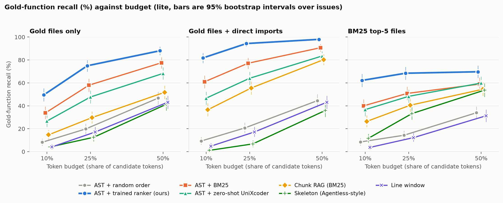

# Learned AST Pruning for Token-Budgeted Code Context

Course project for CSCI-GA 3033-091 (Introduction to LLM Based Generative AI Systems), NYU, Fall 2026.
Anant Kumar (ak10760) and Marcellanous Ellonye (mbe7982).

When a coding agent works on a bug it usually opens whole files, and most of what it reads has nothing to do with the bug. This project trains a small ranker that looks at the issue text and decides, function by function, what the agent should see under a fixed token budget. Functions that look relevant are kept whole, the next ones are kept as signatures, the rest is dropped. Nothing is ever cut in the middle of a function, so the result is still valid Python. The pruner runs as an MCP server, so any MCP client can call it.

The question we set out to answer: does a ranker trained on real bug fixes keep the right functions more often than training-free ranking on the same functions, and does pruning whole functions beat pruning lines or text chunks?

## Results in short

Main test set: SWE-bench Lite, candidate files are the files the gold patch touches plus the files they import. A gold function counts as kept only if every line of it survives. Brackets are 95% bootstrap intervals over issues. Budgets are a share of the candidate files' tokens.

<!-- table:lite_oracle_imports_main -->
Gold-function recall with 95% bootstrap intervals and other metrics, in percent. lite, gold files + direct imports, 274 issues with a gold function.

| Method | Recall @10% | Recall @25% | Recall @50% | Line recall @25% | All-gold @25% | Sig. recall @25% | Precision @25% | Parses @25% |
|---|---|---|---|---|---|---|---|---|
| Line window | 4.8 [2.6, 7.4] | 17.2 [13.0, 21.7] | 43.1 [37.4, 48.8] | 25.0 | 16.1 | 26.6 | 2.1 | 39.4 |
| Chunk RAG (BM25) | 36.5 [30.9, 42.3] | 55.5 [49.7, 61.2] | 80.3 [75.5, 84.9] | 77.7 | 54.0 | 74.3 | 6.0 | 12.4 |
| Chunk RAG (UniXcoder, zero-shot) | 22.4 [17.7, 27.4] | 46.8 [41.1, 52.5] | 69.8 [64.4, 75.0] | 69.6 | 44.9 | 65.3 | 5.1 | 13.1 |
| Skeleton (Agentless-style) | 1.1 [0.0, 2.6] | 6.8 [4.0, 9.9] | 35.9 [30.3, 41.6] | 9.7 | 6.6 | 97.8 | 0.9 | 100.0 |
| AST + random order | 9.3 [6.0, 12.8] | 20.7 [16.2, 25.3] | 44.5 [38.9, 50.1] | 21.1 | 18.2 | 23.2 | 1.2 | 100.0 |
| AST + BM25 | 60.9 [55.2, 66.5] | 77.1 [72.2, 81.8] | 90.7 [87.2, 94.0] | 76.2 | 74.5 | 81.5 | 6.5 | 100.0 |
| AST + UniXcoder, zero-shot | 46.6 [40.9, 52.4] | 64.0 [58.3, 69.5] | 83.5 [79.0, 87.6] | 66.2 | 61.7 | 68.8 | 4.8 | 100.0 |
| AST + trained ranker (ours) | 81.8 [77.2, 86.1] | 94.3 [91.6, 96.9] | 98.0 [96.4, 99.3] | 87.8 | 93.8 | 95.4 | 7.1 | 100.0 |
| AST + trained ranker + BM25 (ours) | 79.6 [74.8, 84.3] | 92.9 [89.8, 95.8] | 97.6 [95.6, 99.3] | 87.0 | 92.3 | 93.6 | 7.0 | 100.0 |
<!-- /table -->



What we take from this:

- **Training helps.** Same nodes, same selector, same encoder architecture. Only the weights differ between "UniXcoder, zero-shot" and "trained ranker". The trained ranker also beats BM25 on the same nodes at every budget. Paired differences with intervals are in [results/tables/lite_oracle_imports_paired.md](results/tables/lite_oracle_imports_paired.md).
- **The gap shrinks as the budget grows**, as we expected. With enough room almost any ranking keeps the right function.
- **Whole functions beat lines and chunks on function recall.** On gold-line recall, which does not care about function boundaries, chunk retrieval with BM25 is about level with BM25 on AST nodes. So part of the advantage of AST nodes is that they keep functions intact, not that they find the edited lines more often. The chunk view parses as Python in about one case out of eight.
- **Something we expected to help did not.** Fusing BM25 ranks with the trained ranker's ranks scores a little below the trained ranker alone.

The same tables for SWE-bench Verified (500 issues), for gold files only, and for files retrieved with BM25 are in [results/tables/](results/tables/). The second test set agrees with the first:

<!-- table:verified_settings -->
Gold-function recall (%) at a 25% budget under each candidate-file setting, verified.

| Method | Gold files only | Gold files + direct imports | BM25 top-5 files | BM25 top-10 files | BM25 top-20 files |
|---|---|---|---|---|---|
| Line window | 16.7 | 17.0 | 13.1 | 14.5 | 15.6 |
| Chunk RAG (BM25) | 27.9 | 54.2 | 33.4 | 43.2 | 55.8 |
| Chunk RAG (UniXcoder, zero-shot) | 22.8 | 44.5 | 30.9 | n/a | n/a |
| Skeleton (Agentless-style) | 13.3 | 8.7 | 29.9 | 41.2 | 50.7 |
| AST + random order | 21.5 | 21.6 | 15.6 | 18.9 | 21.1 |
| AST + BM25 | 53.7 | 73.7 | 49.3 | 59.0 | 67.3 |
| AST + UniXcoder, zero-shot | 48.1 | 66.9 | 46.1 | 52.7 | 61.9 |
| AST + trained ranker (ours) | 73.2 | 92.8 | 63.7 | 74.9 | 83.7 |
| AST + trained ranker + BM25 (ours) | 69.1 | 91.4 | 61.4 | 73.1 | 82.6 |
<!-- /table -->

All tuning was done on the SWE-bench dev split. The test sets were run once, after the choices were written down ([docs/PROGRESS.md](docs/PROGRESS.md), "Choices frozen on dev").

## Quick start

You need Python 3.11 or newer and git. A GPU is optional for the demo.

```bash
git clone <this repository> && cd <folder>
python3 -m venv .venv
source .venv/bin/activate
pip install -r requirements.txt
pip install -e .
```

Run the demo with BM25 ranking. This needs no GPU, no checkpoint and no downloads:

```bash
python demo/app.py --scorer bm25
```

Run it with the trained ranker (needs the checkpoint, see the next section):

```bash
python demo/app.py                         # first sample, 25% budget
python demo/app.py --sample 2 --budget 0.1
python demo/app.py --list
```

Run it on your own code:

```bash
python demo/app.py --root ~/code/myrepo --files pkg/a.py pkg/b.py --issue "crash when x is None"
```

The demo script is an MCP client. It starts `python -m astprune.server` as a subprocess and talks to it over MCP, the same way an agent would. A full walk-through with expected output and troubleshooting is in [docs/tutorial.md](docs/tutorial.md).

### The trained checkpoint

The checkpoint is 484 MB, which is too large for a git repository. Two ways to get it:

1. Download it from the release page of this repository and unpack it to `checkpoints/ranker/best/`. *(Link to be added when the repository is published.)*
2. Train it yourself, see "Reproduce the experiments". It takes about 80 minutes on an RTX 4060.

Without a checkpoint everything still runs: the server falls back to BM25 ranking and says so in its output.

### Use it from an agent

The repository has a `.mcp.json`. Start Claude Code (or another MCP client) in the repository root and the `astprune` server shows up with one tool:

```
get_budgeted_context(issue: str, files: list[str], budget: float = 0.25)
```

`budget` up to 1 is a share of the files' tokens. Above 1 it is a token count. A prompt to try is in [demo/agent_prompt.md](demo/agent_prompt.md). To point the server at another repository, set `ASTPRUNE_ROOT` (see [.env.example](.env.example)).

## How it works

```
issue + files + budget
   -> parse      tree-sitter splits each file into functions, methods, class headers, blocks
   -> score      UniXcoder-base (125M), fine-tuned with a contrastive loss, one score per node
   -> select     fill the budget in score order: full body, signature only, or dropped
   -> render     valid Python, with "# ... N lines omitted" where code was left out
```

Training labels come from real fixes: a node is a positive if the gold patch changed it. Negatives are other nodes of the same file (half of them picked by BM25, so they look like the answer) and nodes from files it imports. Training data is SWE-bench train plus SWE-Gym, 17,325 issues from 44 repositories. None of those repositories is in the dev or test sets, and the code checks that before it builds examples.

More in [docs/architecture.md](docs/architecture.md).

## Reproduce the experiments

Everything needed to check our numbers without a GPU is committed: per-issue results are in `results/runs/`, and this rebuilds every table and figure from them in about a minute:

```bash
python notebooks/build_notebook.py     # or open notebooks/analysis.ipynb
```

To rerun from scratch:

| Step | Command | Time on our laptop | Needs |
|---|---|---|---|
| Labelled dev and test data | `python experiments/build_data.py --split dev` (then `lite`, `verified`) | 5 min, 2 GB of clones | network |
| Training data | `python experiments/build_data.py --split gym`, `--split train`, then `python experiments/build_train_examples.py` | 45 min, 13 GB of clones | network |
| Train the ranker | `scripts/train_main.sh` | 80 min | GPU with 6 GB |
| Pick the checkpoint | `python experiments/train_ranker.py --run-name main --promote` | seconds | |
| Evaluate | `python experiments/evaluate.py --split lite --methods untrained trained --workers 2` | 40 min | GPU with 4 GB |
| Tables and figures | `python experiments/summarize.py --split lite && python experiments/make_tables.py --split lite && python experiments/make_figures.py --split lite` | 1 min | |
| Everything after training, in order | `scripts/run_queue.sh` | several hours | GPU with 8 GB |

Our laptop: RTX 4060 Laptop GPU (8 GB), 16 CPU threads, 12 GB RAM, WSL2. No paid API is used anywhere. Settings that affect a number are in [experiments/config.yaml](experiments/config.yaml). Data sources and label rules are in [data/README.md](data/README.md).

Evaluation runs are skipped when their result file already exists, and training continues from its last checkpoint, so every command above is safe to run again after an interruption.

## Tests

```bash
pytest
```

About 150 tests, a bit over two minutes, no GPU needed. They cover the parser, the selector (never over budget, output always parses, 100% budget returns the file), label building from patches, the baselines, metrics and bootstrap, the MCP server over a real stdio connection including bad requests, and the demo script on the bundled samples.

## What is in the repository

```
src/astprune/        the library: parser, selector, scorers, baselines, metrics, training, MCP server
demo/                MCP client demo, sample inputs, sample files
experiments/         scripts that produce everything under results/
results/             per-issue results, summaries, tables, figures, training logs
notebooks/           analysis.ipynb, rebuilds tables and figures from results/
docs/                tutorial, architecture, error analysis, TA feedback, plan and progress log
tests/               unit, integration and demo smoke tests
report/              final report (LaTeX and PDF)
slides/              presentation
scripts/             training and queue wrappers, docs filler
data/README.md       where the data comes from and how to rebuild it
```

## Limits

- Python only.
- The evaluation asks whether the right code survives pruning. It does not run tests, so it does not show that an agent fixes more bugs with the pruned view. The small downstream check in [results/downstream/](results/downstream/) is a static proxy with a 7B model and should be read as that.
- Issues whose fix only adds new functions have nothing to keep and are not in the recall numbers. The counts are in `results/data/`.
- The ranker reads the first 256 tokens of a function and the first 512 tokens of an issue. A long function is judged by its head.
- If a function is larger than the whole budget it cannot be kept. It comes back as a signature, and the caller has to ask again with a larger budget. This is the most common kind of miss, see [docs/error_analysis.md](docs/error_analysis.md).
- Results are for 12 well-known Python projects. Code that looks very different may behave differently.
- Third-party baselines: what was run, with which model and on how many issues, is stated in [docs/baselines.md](docs/baselines.md).

## Troubleshooting

| Problem | What to do |
|---|---|
| `No trained checkpoint` or the output says "Using BM25 ranking" | Put the checkpoint in `checkpoints/ranker/best/`, or pass `--scorer bm25` to make the choice explicit |
| The demo says it could not talk to the MCP server | Run `pip install -e .` inside the active environment |
| CUDA out of memory during evaluation | Use `--workers 1`. Each worker loads its own copy of the model |
| CUDA out of memory or very slow training | Close other GPU programs. Training needs about 4.2 GB. On Windows and WSL an overfull GPU does not fail, it gets about ten times slower |
| A clone hangs in `build_data.py` | Stop it and run the same command again. Finished clones are reused |
| `data/processed/<split>.jsonl not found` | Run `python experiments/build_data.py --split <split>` first |
| Training was interrupted | Run `scripts/train_main.sh` again, it resumes |

## Credits

Datasets: SWE-bench (Jimenez et al., 2024), SWE-bench Verified, SWE-Gym (Pan et al., 2024). Encoder: UniXcoder (Guo et al., 2022). Parsing: tree-sitter. Baselines and ideas we compare against: Agentless, LongCodeZip, SWE-Pruner, LLMLingua, RepoCoder. Full references are in the report. The files under `demo/sample_repo/` belong to their projects, see the note in that folder.
